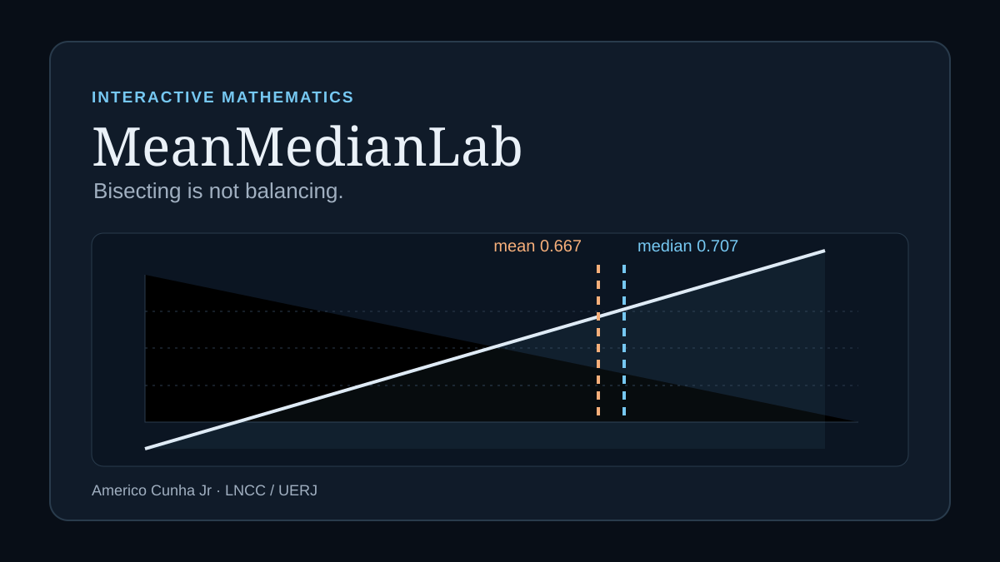

# MeanMedianLab — Interactive Mean–Median Geometry

**MeanMedianLab** is a compact open educational web resource for investigating
the difference between the centroid (mean height) of a homogeneous solid and
the horizontal plane that divides its volume into two equal parts (median height).

The laboratory is the online companion to *Bisecting Is Not Balancing: Means,
Medians, and a Paraboloid*, an expository manuscript by Americo Cunha Jr.

<p align="center">
  
</p>

**Interactive website:** https://americocunhajr.github.io/MeanMedianLab/  
**Repository:** https://github.com/americocunhajr/MeanMedianLab

> The website link becomes active after GitHub Pages is enabled for this repository.

## Table of Contents

- [Overview](#overview)
- [Features](#features)
- [Mathematical model](#mathematical-model)
- [Usage](#usage)
- [Repository structure](#repository-structure)
- [Validation and reproducibility](#validation-and-reproducibility)
- [Author](#author)
- [Citation](#citation)
- [License](#license)
- [Institutional support](#institutional-support)
- [Funding](#funding)

## Overview

If a homogeneous solid is described by a sectional-area profile
$A(z)=Cz^p$ on $0\le z\le H$, the vertical centroid and the volume-bisecting
plane need not coincide. By changing the exponent $p$, **MeanMedianLab** makes
this geometric distinction quantitative and visible, without requiring any
server-side computation.

## Features

- Interactive exponent control for $0\le p\le 12$.
- Presets for the cylinder ($p=0$), paraboloid or wedge ($p=1$), and cone or pyramid ($p=2$).
- Live display of mean, median, normalized gap, and volume fraction below the centroid.
- Probability-density plot with the half-volume region marked.
- Responsive dark interface with keyboard-accessible controls.
- Static HTML, CSS, and JavaScript; no build step or third-party runtime dependencies.

## Mathematical model

For $U=Z/H$ (the normalized height of a uniformly selected point in the solid),

```math
f_U(u)=(p+1)u^p,\qquad F_U(u)=u^{p+1},\qquad 0\le u\le 1.
```

The normalized mean and median are, respectively,

```math
\frac{\bar z}{H}=\frac{p+1}{p+2},
\qquad
\frac{m}{H}=2^{-1/(p+1)}.
```

The fraction of volume below the centroid plane is

```math
F_U(\bar z/H)=\left(\frac{p+1}{p+2}\right)^{p+1}.
```

When $p=1$, the centroid plane leaves exactly $4/9$ of the paraboloid's
volume below it. When $p=2$, the fraction is $27/64$.

The family represents valid nonnegative sectional-area functions for all
$p\ge0$, although profiles with $p>2$ cannot belong to a convex solid
in three dimensions.

## Usage

Clone the repository:

```bash
git clone https://github.com/americocunhajr/MeanMedianLab.git
cd MeanMedianLab
```

Open `docs/index.html` directly in a modern browser, or serve the `docs/`
folder locally:

```bash
python -m http.server 8000 --directory docs
```

Then open http://localhost:8000/ and adjust the exponent slider.

### GitHub Pages

In repository **Settings → Pages**, select **Deploy from a branch**, branch
`main`, and folder `/docs`, then save. The site will be available at the URL
shown above after GitHub completes deployment. The `docs/.nojekyll` file
ensures the site is served without Jekyll processing.

## Repository structure

```text
MeanMedianLab/
├── README.md
├── CITATION.cff
├── LICENSE
├── .gitignore
├── docs/
│   ├── .nojekyll
│   ├── index.html
│   └── assets/
│       ├── css/style.css
│       ├── img/MeanMedianLab-Cover.svg
│       └── js/
│           ├── model.js
│           └── app.js
├── tests/
│   └── model.test.js
└── publications/
    └── README.md
```

## Validation and reproducibility

All numerical indicators come from analytical formulas implemented in
`docs/assets/js/model.js`. A dependency-free test suite verifies exact
reference cases, limiting properties, and probability normalization:

```bash
node --test tests/model.test.js
```

No stochastic sampling is involved: the results are deterministic and
reproducible across modern browsers. Model functions are kept separate
from the visual presentation for inspection and reuse.

## Author

**Americo Cunha Jr**  
Laboratório Nacional de Computação Científica (LNCC)  
Universidade do Estado do Rio de Janeiro (UERJ), Brazil  
https://americocunha.org

## Citation

If **MeanMedianLab** contributes to teaching or research, please cite:

> A. Cunha Jr, *MeanMedianLab: Interactive Mean–Median Geometry*,
> GitHub repository, 2026.

```bibtex
@misc{CunhaJr2026MeanMedianLab,
  author       = {A. {Cunha~Jr}},
  title        = {{MeanMedianLab}: Interactive Mean--Median Geometry},
  year         = {2026},
  howpublished = {GitHub repository},
  url          = {https://github.com/americocunhajr/MeanMedianLab},
}
```

A `CITATION.cff` file is provided for GitHub's **Cite this repository** feature.
See [publications/README.md](publications/README.md) for the associated
expository manuscript. No article DOI is assigned here before publication.

## License

**MeanMedianLab** is released under the MIT license, consistent with several of the author's software repositories. See [LICENSE](LICENSE) for details.

## Institutional support

LNCC — Laboratório Nacional de Computação Científica  
UERJ — Universidade do Estado do Rio de Janeiro

## Funding

This work acknowledges support from CAPES (Finance Code 001), CNPq
(grants 305476/2022-0 and 406148/2022-8), and FAPERJ (grant 204.477/2024).